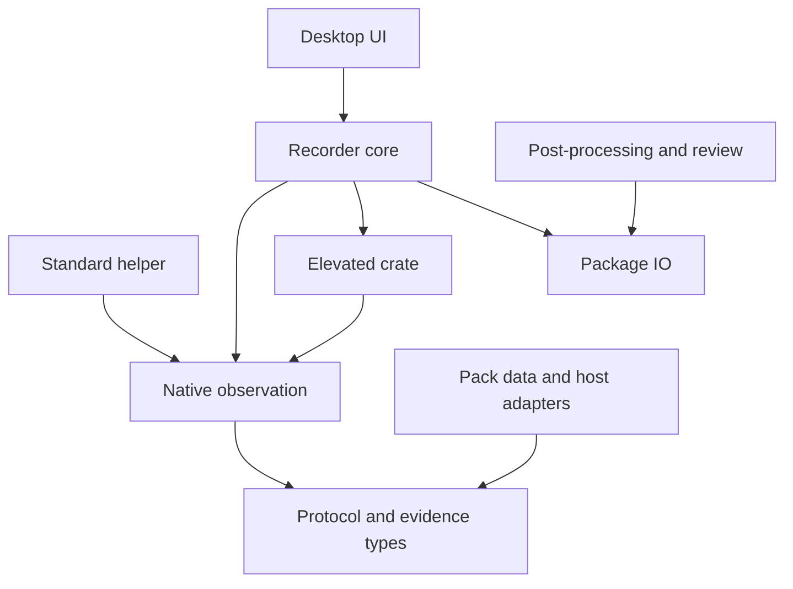

# M1 architecture addendum: stable foundations for M1-M6

Date: 2026-11-15 (Europe/Moscow)
Project: screen_fix / Intercall Recorder
The [elevated capture specification addendum](SCREEN_FIX_ELEVATED_COMPONENT_SPEC_ADDENDUM.md) defines the approved source selection, collector trust boundary and collector lifetime.

## 1. Authority, purpose and limits

Read in order:
1. SCREEN_FIX_M1_SPEC_ADDENDUM.md: accepted amendments, M1 scope and acceptance split.
2. Intercall Recorder technical spec v1 Windows.pdf: target product and normative requirements for every milestone.
3. This architecture: module boundaries, ownership, integration and evolution.
4. SCREEN_FIX_M1_ALGORITHMS_ADDENDUM.md: detailed capture algorithms within these boundaries.

The PDF text governs behavior; screenshots govern visual inspiration only. target.txt and the PDF are not changed. The [capture architecture](SCREEN_FIX_ARCHITECTURE.md) summarizes the current M1 ownership and runtime boundaries.

M1 covers the capture core. Hardware acceptance requires results from the applicable Windows, pen and instrumentation scenarios. M1 reports detected failures without restarting workers, the helper, devices or encoders. Automatic failure recovery belongs to a later milestone.

The goal is extension without replacement of the capture architecture. This does not mean freezing every private struct or implementing every future subsystem now. Stable boundaries are observable data contracts, ownership and package formats. Private code may evolve without forcing unrelated subsystems to change.

The session controller runs on a dedicated thread as required by PDF section 2. Each journal has its own stream writer.

No build, test, benchmark or source migration has been performed as part of this document.

## 2. Target system and stage allocation

The product produces GUI trajectories, native-command data, evaluation/task packs, grading labels and logged video. No single product's missing evidence may silently invalidate unrelated products, and missing evidence must never be invented.

| Milestone | Function added | Existing boundary used | What must not change |
| --- | --- | --- | --- |
| M0 | Existing screen_fix runs | Existing capture code as migration base | Do not repeat M0 as a new design prerequisite |
| M1 | Native capture, selected monitors, segmented video, input helper, context/UIA/pen, live stills, minimal package, diagnostics | Core owners, typed streams, package reader/writer | Raw provenance, clock, ownership and publication contracts |
| Next stage: recovery | Deferred repair/restart work under a separately defined recovery policy | Offline package inspection; component startup/stop/error contracts | M1 must not contain a hidden generic recovery framework |
| M2 | Tasks, start/final files, checkpoints, pack loader/registry, Blender and FreeCAD | Profile snapshot, adapter evidence, file service, verifier runner, attempt workflow | No app-specific branches inside input/screen capture |
| M3 | Production privacy, auto-pause, blackout, own-window exclusion, review cuts/fills/blur | Prepublication decisions and versioned package transformations | No path bypasses publication or uploads unreviewed files |
| M4 | Normalization, product gates, eight exporters, MCAP/views, annotations/checkers/replay, upload | Package reader, raw references, immutable release inventory | No buyer-specific capture code or destructive raw normalization |
| M4b | Real contributor pilot and performance measurements | Counters and versioned configuration snapshots | Targets become measured limits without a new architecture |
| M5 | Adobe adapters/verifiers, capabilities and coverage; each app starts with its profile-only tier | Same hub, pack contracts, file service and pipeline mapping | No assumption that every host is Python, pipe-capable or has identical save APIs |
| M6 | 3ds Max script adapter and version-specific native sensor | Same adapter envelopes and checkpoint/verifier contracts | SDK/ABI dependencies remain outside recorder core |
| Later platform port | Platform capture/input/context implementation | Common session, package, UI and evidence types | No Win32 handle or D3D type in portable domain APIs |

Recovery is scheduled after M1, but its exact work package and acceptance are not implied to be completed by the existing M2 tasks alone.

The generic M2 profile loader can already support profile-only applications without native adapters. Shipping a particular Adobe profile and shipping its M5 adapter are separate events; profile-only support does not wait for that adapter. This does not move all Adobe integration tests into M2.

## 3. Process topology and dependency direction

The Recorder runs asInvoker with UIAccess disabled and launches the standard UI-less input helper under its existing token. An inherited high-integrity token can cover an eligible foreground through this topology. An approved foreground requiring additional access can add the independently elevated collector on demand from an eligible medium-integrity Recorder:
- Desktop/Recorder owns the UI, controller, WGC, GPU, encoding, stills, approval and all file/report publication.
- Standard input helper owns native input collection through restricted inherited IPC and parent-lifetime job coupling. It runs asInvoker with UIAccess disabled.
- Elevated collector owns only typed target-scoped input and native context observation, its independent witness and attachment lifetime. It runs with requireAdministrator and UIAccess disabled for one Recorder attachment. Its source graph excludes the core, UI, WGC/GPU capture, video, package and exporter. It exposes no service, general native command execution, target memory/file access or process spawning.

App adapters run inside their respective applications and obey those hosts' threading rules. They are not Rust dynamic libraries loaded into the core. After Stop, verifier subprocesses may be launched with the PDF resource and isolation restrictions. Those later verifier subprocesses have their own contracts.

Server responsibilities remain separate: task catalog, signed pack registry, upload storage plus processing/review pipeline. No cloud service is needed to consume a frame or input event. Updates/pre-flight occur before recording; upload and server processing begin only after recording and the required review/consent.

Logical dependencies:

Arrows show source dependencies. The core links the elevated crate for the Recorder-side launcher and endpoint APIs. The elevated binary is a separate entry point built from that crate and launched through Windows only for a protected capture request. Core receives profile values and adapter messages.

### Rust workspace shape

Use a small workspace matching the PDF layers, not a crate per subsystem:

| Package/location | Contents | Dependencies excluded |
| --- | --- | --- |
| protocol/ | Lightweight IDs, wire types, schema versions, shared input IPC records and validation | GUI, database, D3D/MF, network clients |
| core/ | Session, clock, capture orchestration, context/text gate, package IO, profile contracts and platform implementations | eframe and app SDKs |
| core/capture/input/ (helper package) | Helper binary and input-specific Windows implementation | core capture/video implementation, eframe, redb |
| core/capture/native-observation/ | Shared Windows input and typed native observation mechanisms | GUI, core session, GPU, package IO |
| core/capture/elevated/ | Protected collector executable, Recorder-side endpoint mechanics, Windows trust and authenticated transport | Core recording algorithms, GUI, video, journal writers |
| ui/ (desktop binary) | egui/eframe shell, native dialog integration and composition root | App-native SDKs and server exporters |

The helpers depend on native observation and protocol. The Recorder links the Recorder-side protected endpoint code and owns input normalization for both sources. Protocol contains portable typed evidence, framing records and bounded validation.

The PDF core/capture/screen, input, context, files; privacy; hub; package; packs; pipeline; tools remain logical locations. Cargo manifests and source paths can reflect them without one package per directory. Existing source files should be moved only when the ownership/dependency split needs it.

Keep tools for inspection and verification out of default production runtime dependencies. Avoid adding framework dependencies merely to wrap threads, queues or file IO.

## 4. Module contracts and ownership

| Module | Owns | Receives | Publishes |
| --- | --- | --- | --- |
| session | Capture lifecycle, admission epochs, pause reasons, session configuration and final outcome | UI/hotkey requests; health/owner completion | Boundary commands, status snapshots, manifest facts |
| clock | QPC origin/conversions and UTC anchor collection | Platform time readings | Typed times and anchor values |
| capture::screen | Per-monitor WGC/device/context, source-frame identity, retained textures, thumbnail/readback | Capture configuration; observation requests; privacy decisions | Frame/sample leases, pixels and observation outcomes |
| capture::video | Encoder/muxer, segment inventory and bounded input work | Samples and boundary commands | Encoded-slot outcomes and segment completion |
| capture::observations | Trigger state, temporal selectors, priority/retention requests | Early input candidates, confirmed classification, frames, save evidence | Retain/release requests and logical observation outcomes |
| Native input producers | Native loops, source queues and descriptors | OS input and immutable source configuration | Timestamped input evidence and progress |
| Protected launcher and selector | One launch ticket, peer, current and closing source visits | Controller boundaries, exact target proof, authenticated lane results | Selected evidence, exclusive cuts and typed source milestones |
| Elevated witness and supervisor | Local grant proof, parent/lease status and deadlines | Foreground, desktop/session, owner and provider progress | Gate state and bounded invalidation/termination |
| capture::input/gate | Matching, private/published held state, sensitive-data classification and ordered pending records | Selected producer evidence, focus/approval context | Publishable input and resolved trigger references |
| capture::context | Windows/focus/display/cursor observations | Native notifications and UIA results | Value-only context and geometry snapshots |
| context::uia | UIA COM objects and subscriptions | Bounded requests with focus/geometry generation | Value-only results with request times and uncertainty |
| privacy | Admission rules and decisions; later blackout/review policy | Profile and approval/window evidence | Bounded decisions, masks, pause/cut requirements |
| hub (M2/M5) | Local adapter connections, authentication, capability/session identity | Adapter envelopes | Accepted app evidence, clock sync, tier/coverage facts |
| capture::files (M2) | File observation/copy/checkpoint state, not the live application's document | Save evidence, explicit checkpoint request, profile rules | Copied artifact identity and verification work |
| package | Package paths, per-stream writers, segment/image inventory, manifest publication | Accepted facts and writer completion | Closed package and read-only descriptors |
| catalog (when persistence is needed) | redb connection/transactions, settings and local task/attempt index | Low-rate metadata requests | UI/catalog values |
| postprocess (M3/M4) | One job's revision, derivation/gate/export state | Closed package revision and explicit policy | Validated revised package and reports |
| upload (M4) | One immutable release upload and resumable progress | Consent and validated release descriptor | Transfer outcome; no live capture access |

A module is not automatically a thread. Ownership determines who changes data; execution placement determines whether slow work can block a latency-sensitive path. Both must be explicit.

The observation selector is app-neutral. It does not normalize full training actions or decide that a native operation succeeded. File verification and native completion evidence remain separate from visual settled.

No subsystem receives a universal CoreContext containing all queues, tasks and resources. Route only the commands and facts it consumes. Do not introduce a broadcast bus for every record or a shared mutable session object queried by every worker.

**Permitted process-wide state (explicit exceptions to "no global mutable state").** Each item is an atomic latch or counter, a once-initialized immutable value or callback context for a native callback without a user-data pointer, with one documented purpose. In the core crate:
- `RECORDING_OWNED` (`session/windows.rs`): the process-wide one-recording latch.
- `REPORT_SERIAL` (`package/diagnostics.rs`): a counter that makes diagnostic report names unique.
- `DESKTOP_SIGNALS` (`session/windows/environment.rs`, thread-local): the context of the out-of-context desktop WinEvent callback, which has no user-data pointer. The message loop clears it before removing the hook.
- `IN_FLIGHT` (`platform/windows/elevated/launcher.rs`): the one-flight latch of the elevated launch. It stays set until the shell call returns, so consent prompts cannot stack across attempts.
- `RESOLVER_ACTIVE` (`platform/windows/context/identity.rs`) and `CLASSIFIER_ACTIVE` (`platform/windows/elevated/selector.rs`): single-owner latches. No replacement resolver or classifier starts while an earlier one may still be blocked in a native call.
- `FUNCTIONS` (`platform/windows/mf.rs`): the Media Foundation function table, loaded once and immutable afterwards.

In the shared native crates `screen-fix-native-observation` and `screen-fix-elevated`, linked by the Recorder and, as applicable, the standard helper and the collector:
- `KEYBOARD` and `POINTER` (`native-observation/src/input/hooks.rs`): the lock-free rings that the low-level hook callbacks write, because those callbacks have no user-data pointer. One hook owner per process holds them at a time, through an exclusive claim released when that owner is dropped; a second concurrent owner fails to start. `PROGRESS_PENDING` coalesces progress probes posted to the hook thread, and the thread-local `SCOPE` holds the hook thread's capture scope, set once before the hooks are installed.
- `ACTIVE` (`native-observation/src/events.rs`, thread-local): the context of the WinEvent callback on its installing thread, cleared after unhooking.
- `SERIAL` and `CHANGES` (`elevated/src/runtime/witness.rs`, thread-local): the context of the collector witness's WinEvent callbacks.
- `DRAINING` (`elevated/src/pipe.rs`): a counter of abandoned overlapped pipe operations whose buffers are retained until the kernel acknowledges cancellation. While it is nonzero, no new attachment starts in that process.

**Known M1 deviation: worker-mutated session facts (S4 reduced).** The controller-owned `Facts` are not yet mutated only by the controller. Workers change them through `WorkerSession` methods under the lifecycle lock. The full move to a bounded owner/message channel was deferred by the remediation plan because it fixes no observable defect. The mutating methods are:
- source selection and evidence: `require_source_change`, `abandon_source_preparation`, `source_ready`, `source_pending`, `source_enhanced`, `update_standard_evidence`, `update_elevated_evidence`, `elevated_registration`, `record_source_coverage`, `restrict_source_coverage`, `record_uncertified_tail`, `record_source_blind`, `source_resynchronizing`, `fail_classified_source`, `fail_source`, `required_elevated_hook_failed`, `source_finalization_failed`;
- faults and health: `report_fault`, `report_health`, `video_failed`, `set_video_report`, `input_failed`, `set_input_report_for`, `set_input_report`;
- lifecycle and boundaries: `request_stop`, `mark_input_prefix`, `finish_video_pause`, `finish_pause`, `complete_prefix`, `authorize_complete_publication`, `verify_startup`, `startup_step`, `video_ready`, `input_ready`, `window_coverage`, `windows_evidence`;
- drained notices and environment: `take_fixture_saves`, `take_hotkeys`, `request_journal_flush`, `take_input_environment`, `take_elevated_environment`.

The lifecycle state machine is one phase value with several latch flags, not one enum. Its states, transitions and latches are documented on `Facts` in `core/src/session/windows.rs`. Suspend data is read only through `WorkerSession::suspend_marks`. The power, desktop and window-message callbacks run inside `catch_unwind` and take no lock.

## 5. Threads, blocking and queues

Use standard Rust threads and bounded channels for these native workloads. No async runtime is required for M1. Future local/network transports can use their own event-driven implementation behind hub/upload boundaries; they must not impose an executor on capture.

- UI thread renders snapshots and sends commands. It performs no capture, database transaction, hashing, PNG encoding, manifest flush or blocking adapter request.
- Session controller has its own thread. It owns transitions and does not write files directly.
- Each monitor has a capture thread, as VID-12 requires. All immediate-context operations stay there.
- Video/mux work is isolated from capture so synchronous Finalize cannot block frame collection. One worker per monitor initially is sufficient.
- One PNG worker initially; increase up to the PDF limit only on measured need.
- Native producers run the required Raw Input and hook loops. Callbacks copy bounded evidence; matching stays on the Recorder Receiver.
- Context has its main hidden-window loop, separate location-change callback loop and UIA worker. Optional clipboard reading has its own isolated worker; delayed rendering never runs in the journal writer.
- Journal IO uses one writer per logical stream, not one writer per producer/monitor. The frames stream merges per-monitor record values without carrying GPU data.
- A catalog worker owns redb writes. It is never on the per-frame/per-key path.
- File service adds the PDF two workers in M2; the adapter hub adds its own IO owner.
- Post-Stop package processing, verifiers and upload use bounded jobs independent of capture owners.

Queue overflow policies are contract-specific: input/context drop-newest with out-of-queue gap counters; stills use IMG priorities; video records skipped slots. Control/boundary delivery has reserved capacity or a separate bounded control queue so a full data queue cannot swallow Stop. This is lifecycle signaling, not a general internal RPC system.

Each admitted request has one terminal outcome or a recorded deadline/failure. Data counters distinguish offered, retained, suppressed, dropped and persisted. Progress/ordering markers are local to the stream, never a global barrier across all capture paths.

A frame is copied from WGC into recorder-owned storage then the borrowed frame is closed as VID-12 requires. Owned surfaces remain alive until consumers release them. Treat encoder sample ownership, staging copies and PNG buffers explicitly; no assumptions that input acceptance means GPU consumption is complete.

Native resources cross thread boundaries only where their actual API/threading contract permits it. Do not add blanket unsafe Send/Sync implementations to make a planned queue compile. Keep thread-affine COM objects on their owner and use the required native handoff/marshalling or a value-only request; immediate GPU-context work stays on the capture thread.

Instantiate the catalog worker only when persistent settings/catalog functionality is actually used. Do not create an empty M1 database/service merely to reserve the architecture boundary.

Protected attachment uses a single guarded launch, a bootstrap tied to the exact shell-returned process, then bounded role-separated control, input and context pipes. Both endpoints check the actual peer process and installed image. Scope and per-lane HMAC proofs bind the connection, role and runtime state. Data pressure has explicit loss or timeout handling and cannot occupy the control reader. There is no global channel-discovery entry point.

The collector witness and lifetime supervisor are independent of UIA/IME, writers and native producer joins. The supervisor watches the pinned parent, monotonic lease, local witness, owner progress, provider deadlines and bounded teardown. Revocation closes target work; if cleanup stalls, the supervisor terminates the collector independently. The elevated process spawns no children. The hook and scoped text-edit copy gates consume the current witness, exact scope or revision, and attachment and grant lease deadlines. The supervisor owns bounded host termination independently of those callbacks.

## 6. Lifecycle: capture versus product workflow

Keep two related state dimensions under one controller/workflow owner:

1. Capture lifecycle: Idle, Starting, Recording, Paused, Stopping, Finished/Failed.
2. Attempt workflow: Idle, Pre-flight, Recording/Paused, Finishing, Review, Upload, subsequent delivery/review status.

M1 implements the capture lifecycle and a minimal workflow wrapper. M2 adds task pre-flight and final-file work; M3 adds review; M4 adds eligibility and upload. Capture Finished means the streams are closed, not that final artifacts were verified, review passed or upload completed.

Pause reasons are a set. The controller is the only owner that opens/closes global recording admission. Privacy supplies decision evidence, not a competing state machine. Capture/file/input owners enforce the published boundaries locally.

Use a session/attempt identity for an entire recording. A monitor format change gets a new geometry/capture epoch, not a new attempt. A focus generation identifies UIA relevance only. These are concrete lifecycle identifiers, not a generic generation-based worker replacement framework.

In M1, standalone recording has an attempt ID and optional task binding. Do not fabricate a task goal/family/start assets. M2 supplies real task_id and family_id and selects the task-root location before Start. The relative contents of an attempt do not change when it belongs under task/attempts/.

Before Start, the controller receives an immutable resolved configuration: selected monitors, profile values, output root, calibration metadata, allowed identities and effective capabilities. UI mutation cannot race with a live attempt. Configuration changes take effect through explicit boundaries or the next attempt.

The PDF countdown occurs before recording admission opens, under controller timing; a delayed UI repaint cannot redefine the capture start boundary.

The controller owns exact foreground admission and all independent pause reasons. The selected source owns per-visit proof, not global state. The decision to switch from the standard source to the collector latches the old epoch and clears frame approval on detection. A rapid foreground return cannot reactivate it while Pause is pending. The controller opens a fresh epoch after selected readiness and exact proof. When a configured collector is idle, a new live preparation derives its approval from the actual foreground. The collector activation/resync barrier controls subsequent media and input eligibility. Attempt ID, common clock and stream ownership survive both handoff directions. The standard helper stays attached and drains privately while inactive. A healthy attached collector can stay capture-closed for the current lease. During Pause and Stop, the selector services control and independent data lanes within the relevant closure bounds. Collector cleanup acknowledgement and Recorder certification are separate outcomes. The Recorder can retain only the prefix supported by the input and context lanes and the earliest applicable cutoff.

## 7. Capture and publication boundaries required in M1

### 7.1 Frame path

Platform frame -> recorder-owned source frame -> prepublication policy -> admitted image -> video conversion/encoder and still readback -> file/inventory writer.

The policy boundary is mandatory even in M1. M1 implements its scoped allow-list/boundary behavior without allocating the future 200 ms hold queue. M3 adds the hold and masking at the same boundary.

Keep source identity distinct from persisted image content:
- Source frame: monitor, frame ID, source/receipt time, dimensions, geometry epoch.
- Published observation: source reference plus applied policy/revision and image artifact.
- Video slot: presentation time plus source observation reference.

A mask can change pixels without changing which source frame was observed. Hashes identify resulting content, never event identity. Do not hash unmasked pixels for a persisted image and later attach that hash to a masked image.

Retention needed by before/seen and the future privacy hold may share the same immutable source frame. Masking writes a controlled destination or an exclusively owned unshared surface; it must not mutate a texture already being encoded/read by another consumer. This is a narrow frame-pipeline lifetime rule, not a universal GPU memory manager.

For collector-backed visits the policy includes the exact source visit and exclusive certified interval. Native frame history shares its bounded retention with private frames awaiting proof. Converted samples, still readback, PNG and MP4 owners use the same visit cut for work awaiting publication. An authorized original slot keeps its PTS when proof arrives within bounds. The collector holds no frames or pixels.

### 7.2 Input/context/app/file paths

Every persisted payload passes its stream's publication decision:
- Input gate handles focus/password classification before any per-key persistence.
- Context publication removes non-approved identity details and, in M3, applies full scrubbing/pause policy.
- Hub publication later sanitizes adapter payloads/logs before journal append.
- File publication later distinguishes internal full paths needed for IO from exported tokenized paths.

Keep publication decisions as immutable values shared where needed. Do not pass other owners' write access to a privacy callback. No ordinary subsystem writes around the journal/image/segment interfaces.

Reserve snapshots before UIA/matching can evict eligible frames, but keep speculative reservations private until classification permits them. Sensitive suppressed keys must not leak through per-key snapshot/drop metadata or diagnostic dumps.

Protected input and context pass a local high-side gate before egress and the ordinary Recorder gates before publication. The shared Receiver and Context owners preserve provenance, context revision checks, privacy classification, actual source timestamps, and durable journal reference allocation. Checkpoint and fixture Save consumers require the current selected visit and use the original control or Save receipt against its proof before routing. Reader-side staging losses retain their visit and original uncovered QPC and native gaps across Pause or Stop, using the context journal's monotonic receipt for the loss row. Clipboard contents and monitor/cursor decisions stay with the Recorder. Source health and retained-prefix status flow to the current UI, diagnostics and optional package source evidence. The package reader exposes the standard helper fields alongside optional selected-source evidence.

### 7.3 Why M3 does not replace M1

M3 adds:
- Bounded delayed publication keyed by source/receipt time.
- Per-frame mask planning and geometry evidence.
- Unified pause-cutoff policy with the PDF coarse-time uncertainty.
- Own-window exclusion through the UI's platform window-lifecycle hook.
- Post-Stop revision transformations.

M1 already exposes the required timestamps, epochs, source references and prepublication locations. M3 changes the policy implementation and queue capacity, not Raw Input registration, WGC collection, encoder ownership or package format from scratch.

Closing a video slot selects its source and original PTS; it does not force immediate publication. In M3 retain that closed-slot decision and the still/input decisions until the required privacy horizon and applicable foreground/geometry verdict are resolved. Then forward the original timestamps, or resolve an explicit privacy suppression/gap. A 200 ms publication hold must neither shift capture/slot PTS nor turn a merely held frame into an encoder-loss row. The bounded output delay and required capacities belong to the policy configuration. Shared frame retention avoids duplicate copies where history and privacy hold overlap.

A late_pause that affects already persisted content creates a mandatory correction for the closed/review revision. Gates 7/8 and Submit remain blocked until the affected streams/files have been transformed and revalidated. Do not treat a diagnostic late_pause row alone as removal of private data.

M1 is explicitly not privacy-ready for release. Adding a policy hook is not evidence that full PRIV requirements are implemented.

## 8. Durable data, redb and package identity

### 8.1 Authority

| Data | Authoritative representation | redb role |
| --- | --- | --- |
| Settings and local UI preferences | Versioned redb records | Primary storage, one writer |
| Recorded evidence | JSONL, video, PNG, manifest under the attempt | Index only; never a second authoritative event log |
| Task goal/start state/criteria | Task documents/assets, versioned by task | Local catalog/cache |
| Pack definition | Signed versioned pack directory | Installed-version/catalog metadata |
| Checkpoint/media content | Files/blobs identified by hash | Reference/index metadata |
| Human review, consent, annotations | Durable package/review records | Query/index metadata, not a replaceable derived cache |
| Upload progress | Upload job state keyed by release identity | Persistent resumable progress in M4 |

redb is the selected engine whenever local database persistence is required. Introducing a new persistent settings/catalog feature is not itself a mandatory M1 capture requirement. M1 can use explicit in-memory configuration and the attempt manifest; retain any existing needed persistence through this boundary. M2 introduces the task/attempt catalog. This distinction avoids expanding M1 merely because a database has been selected.

Do not put every frame, input packet, video byte or PNG in redb. Do not add a second database. No cross-file/redb atomic transaction is assumed: first publish the authoritative file/manifest, then update its catalog index. A failed catalog update does not invalidate successfully saved recording bytes or falsely report a complete index.

M1 reports catalog failures. Later reindex/recovery reads existing packages and repairs the index only; it does not rewrite raw evidence to match an old database row.

Large asset blobs and reference counting arrive in M2, keyed by SHA-256. Do not generalize still-image BLAKE3 names into the native-file hash contract. Active/pending attempt references prevent deletion. A release revision references exact asset versions, not a mutable path outside the package.

### 8.2 Stable layout and schemas

Use the PDF attempt-relative layout from M1: manifest.json; raw/input.jsonl, context.jsonl, frames.jsonl, stills.jsonl; raw/video/<monitor>/; raw/images/ and raw/cursors/. M2 adds raw/app_events.jsonl, raw/files.jsonl, app logs, files/checkpoints and files/final, outcome.json and rights.json. M3 adds redactions.jsonl and review entries; M4 adds derived, annotations, exports and QA artifacts.

The workflow owner supplies outcome/checklist/debrief and rights/consent decisions. package::metadata is the sole physical writer of manifest.json, outcome.json and rights.json for a mutable attempt/revision; it accepts typed update requests, performs IO away from the controller and reports completion. Review owns redaction decisions and requests append to redactions.jsonl through the package writer. After capture closes, the same metadata publication boundary hands exclusive mutation authority to the post-processing job; capture and review never concurrently overwrite the manifest. Server expert reviews are appended by the server package metadata owner with review identity and a new checksum inventory.

rights.json records agreement/version/hash, consent scope and withdrawal status/date. Recording/task consent appears with M2 workflow; M3 records review decisions; M4 binds explicit Submit consent to the exact validated revision. Withdrawal invalidates eligibility/upload authorization for that revision and is propagated to retention/delivery handling. outcome.json stores declared task outcome, verifier results and expert reviews separately from capture completion. The checked release inventory is produced by the package gate job, not supplied as trusted data by the UI; its descriptor can be constructed only after those checks succeed.

Centralize relative-path resolution in package IO. An API receives an artifact ID/reference, not an arbitrary path concatenated by a UI or adapter. Preserve PDF on-disk names and relative URI rules.

Version schema envelopes and keep explicit unknown/unavailable outcomes. Use typed known fields; allow bounded namespaced application payloads where schemas genuinely vary. Do not replace the whole protocol with serde_json::Value.

Capture records retain source references, sequence, uncertainty, geometry/DPI, profile/pack versions and coverage. Later normalization can interpret them without recording again. Unknown new event kinds remain preserved but not silently treated as known commands.

Only append raw records during recording. M2 verification completion appends a result referencing the checkpoint ID rather than patching its earlier unknown row. After completion, raw mutation is allowed only by the PDF redaction/deletion contracts.

M1 package completion, data-quality gaps, later review validity, per-product eligibility and upload/delivery status are different values. A single success boolean is insufficient.

## 9. Profiles, adapters and app-specific code

### 9.1 M1 profile seam

Core consumes a small resolved profile value, not app names. The M1 stub allow-list/profile provider implements the same input shape that the M2 loader will fill. It supplies explicit test/selected identities; no hidden hardcoded Blender/Adobe special case.

Do not implement the registry, signed-pack installer or full TOML language in M1 merely to populate a handful of fields. Define fields actually consumed now; version and extend the schema when M2 needs the remaining PDF data.

### 9.2 M2 pack loader and snapshot

The loader verifies signatures/versions, validates profile fields and resolves platform paths before use. Pack updates happen before pre-flight; an attempt records the exact selected pack version and effective profile. Do not hot-swap rules underneath a recording.

The registry also supplies APP-12 pack/adapter-version disable decisions (kill switch). Pre-flight applies them before activation: a disabled adapter is not started and the application uses its permitted lower tier. Check installed adapter versions and offer the specified one-click repair during pre-flight; this installer operation is distinct from deferred capture-fault recovery. Record the effective disable/version/capability decision. A newly received disable decision must not silently mutate a running attempt's profile: any required runtime deactivation is an explicit capability/tier transition through the hub, with OS capture independent.

A pack contains profile data and optional adapter/verifier/mapping/test artifacts. Paths, helper names, pause windows, file types, logs, shortcut/preference rules, supported versions and coverage belong to the pack.

A configuration profile may select known generic facilities, not arbitrary code executed in the recorder process. Verifiers and host adapters execute in their designated processes. Complex event mapping belongs to versioned pipeline/pack processing code, not a new general-purpose scripting VM inside capture.

### 9.3 Hub protocol

Keep the helper IPC distinct from app adapter protocol. Helper IPC is a trusted launched-child high-rate channel with restricted inherited/shared-memory handles. Adapter transport is local named-pipe JSONL or later loopback WebSocket with the PDF peer-owner validation; hello.pid is never sufficient authentication.

Transport handlers normalize to a common accepted envelope:
- Connection/session/attempt identity and validated app instance.
- Pack/adapter/protocol version and capability snapshot.
- Channel, event kind, source and receipt timing/uncertainty.
- Document identity and sanitized payload.
- Status/phase and explicit inference/coverage metadata.

Requests have IDs and a concrete capability name. Only advertised capabilities may be requested. Unknown/timeout is not successful completion. Disconnection leaves OS capture working at its actual tier; later reconnect produces explicit tier/capability transitions. This future adapter degradation policy does not reintroduce M1 worker recovery.

Do not make input wait for an adapter response. Busy hints are small values; the adapter also obeys its own host restrictions. A timed-out host call remains outstanding until its callback actually returns where the PDF requires it; timeout does not authorize another overlapping call.

### 9.4 M5 and M6 fit without changing core

| Pack/host | Difference owned by the pack | Stable recorder contract |
| --- | --- | --- |
| Blender | Main-thread Python only, polled/log evidence, per-version operators/history, checkpoint side-effect restrictions | Timed app events, context geometry, confirmed saves, explicit coverage |
| FreeCAD | Transactions versus command IDs, document/task-dialog observers, saveCopy and dependent documents | Same envelope, copy confirmation and verifier result |
| Photoshop UXP | WebSocket, notifications/history/tool-modal evidence, silent intervals, copy permissions, descriptor scrubbing | Capability handshake, evidence/status, bounded payloads and checkpoint protocol |
| Premiere UXP | Serial state diffs, playback restrictions, user/autosaves only, unstable item IDs, generated assets | Native/state evidence with confidence, stable artifact references, no forced saveAs |
| After Effects CEP/AEGP | One outstanding evalScript, revision diffs, optional native sensor, no deep reads while busy | Bounded requests and timed results; command observed does not mean completed |
| Illustrator CEP | Sparse events, summaries and user-save copies, post-Stop SVG/PDF verification | Low-tier evidence remains valid; no invented command coverage |
| 3ds Max scripts/native sensor | Main-thread host API, per-version .gup ABI, table-scoped command IDs, batch verifier | Namespaced events, versioned capabilities, save/copy and coverage contracts |

Python/JS/native SDK code explicitly required by the PDF stays in packs/verifiers. The recorder remains Rust. C++ sensors are limited to the host SDK requirements in the later stages; they do not become dependencies of the Rust core or helper.

## 10. Files, checkpoints and verifiers (M2)

The file service owns file observation/copy status and artifact identities. The adapter owns API calls inside the user's application. A checkpoint request is not a save; save evidence is not yet a stable copy; a stable copy is not yet a successful reopen.

Lifecycle:
CheckpointRequested -> SaveConfirmed -> StableCopy -> HashedArtifact -> VerificationPending -> VerificationResult.

Unavailable operations remain explicit. Profile-only packs may leave a checkpoint request waiting for a user save. No generic core function assumes all applications support safe copy-save.

The file service:
- Receives save/rename evidence and applies the PDF stability/copy checks.
- Opens/copies with platform-appropriate sharing rules.
- Separates user saves from adapter-generated copies to prevent recursive checkpoints.
- Stores immutable artifact IDs and original/relative-layout mappings.
- Emits checkpoint evidence for the existing observation selector.
- Writes only packaged copies; it does not repoint the user's active document.

Verifiers run after Stop on packaged copies through a restricted process runner, with explicit timeout/memory/network policy and structured results. A parser refusal, unsupported format or missing license is not a task failure. Readiness for different products follows QA rules.

Version-specific readers, headless app binaries and parser coverage belong to packs. Their summaries feed the pipeline but cannot mutate live capture state. M1 needs only a typed confirmed-save/checkpoint seam and fixture producer, not a premature production verifier framework.

## 11. Review, revisions and privacy transformations (M3)

The review service reads a closed package. It cannot call into live capture owners or modify a texture in use.

Each edit job is bound to an input package revision and a list of redaction operations. Track source-to-output dependencies by concrete artifact/reference lists: affected segments, images, event ranges, app logs, checkpoints/final files and derived outputs. A generic graph database is unnecessary.

Transformation sequence:
1. Create a private staging revision.
2. Apply cuts/masks/fills and rewrite affected references.
3. Re-encode and revalidate affected video; rehash edited PNGs.
4. Scrub or withhold affected structured/native artifacts.
5. Rebuild invalidated derived outputs, manifests and checksums.
6. Run required gates and publish the new revision descriptor only after success.

A failed edit does not expose a half-rewritten package. Review/submit references exactly one revision. New edits invalidate its prior release validation and consent-to-submit binding; the UI must not accidentally upload a superseded revision.

The revision descriptor is internal control metadata alongside the PDF package, not a second public data format. It identifies the exact inventory/digest and edit generation; delivered contents retain the PDF layout.

Do not claim universal automated semantic redaction across native files. PRIV-6 requires review of copies beyond the chosen interval: if a format cannot be safely scrubbed, withhold affected artifacts or block the relevant release until resolved. A visual rectangle alone cannot prove removal from a PSD, checkpoint, prompt or later screen frame.

Working originals and incomplete staging directories are never directly enumerated by the uploader. A reviewed revision with no edits may reference the exact existing immutable artifact bytes; unchanged files in an edited revision may also be reused. Only artifacts in that revision's checked inventory are upload inputs, so no mandatory full-recording copy is introduced. Once the revision is committed, superseded sensitive files are deleted or withheld according to redaction/withdrawal requirements and active references; do not keep an indefinitely accessible secret backup under a hidden revision folder. Shared blobs require checking all affected references without damaging unrelated valid attempts.

Human/model annotations are durable authored records. Rebuilding derived steps preserves them with their original author/model/prompt provenance; if old step links no longer resolve, retain an explicitly unlinked/invalidated annotation instead of silently deleting it.

## 12. Post-processing, eligibility and server pipeline (M4)

### 12.1 Read-only processing inputs

PackageReader opens a closed revision and validates schemas/inventory. It exposes typed streams, artifacts and provenance without any capture access.

Normalization produces canonical steps/operations and state deltas from raw evidence. App mapping is separately versioned. Eight action-format exporters consume canonical steps and pinned format profiles, never each implement their own raw-input classification.

Facts and inferences remain separate. Captured input/frames are not overwritten when a model label, pack mapping or exporter improves.

Local provisional normalization for review and server authoritative recomputation use the same versioned contract and golden fixtures. Where practical, share the deterministic Rust normalization implementation through a small library/CLI entry point; do not force the server into the desktop GUI dependency graph. Python packaging code for OWA/MCAP and delivery loaders stays server-side as the PDF requires.

### 12.2 Gates and product eligibility

A gate runner emits structured pass/fail/not-applicable/not-run results with evidence and versions. UI text is rendered from these results, not used as control logic.

- Gates 7 and 8 plus explicit consent block Submit.
- Gates 1-6 affect the products that require them.
- Server gates 9-13 apply to the corresponding exports/deliveries/pack channels.
- An attempt eligible for no product is not delivered.

File completion, review acceptance and product eligibility are separate. Coverage tiers/windows/not-covered lists are recorded per channel/version and actual attempt, not assumed from the installed pack's maximum capability.

Model texts, target boxes, segmentation, replay and checker results are independent versioned products attached by stable references. Their failure cannot prevent raw capture from having completed. Maintain family_id for train/test separation and cross-view identity from M2 onward.

### 12.3 Upload and delivery

Uploader accepts only a closed validated ReleaseDescriptor: attempt ID, revision/inventory digest, file list, checksums, gate result and consent binding. It has no method to enumerate arbitrary raw folders or upload directly from a recording worker.

Avoid a consent/checksum cycle. First freeze the reviewed content and compute a review-content digest over its explicitly listed files, excluding rights.json and generated checksum inventories; include the resolved consent scope/agreement version as separate inputs to the consent decision. Record Submit consent against that digest in rights.json. Then rebuild the final PDF checksums.sha256, including the final rights.json, recheck required gates and freeze the upload inventory. ReleaseDescriptor binds both the review-content digest/consent decision and the final upload-inventory digest. This additional internal review digest does not weaken the PDF checksum coverage. Any content or consent-scope change requires a new review binding. Withdrawal cancels authorization and pending upload independently of the old frozen descriptor, creates updated rights/checksums under a new revision, and is propagated to the server; do not mutate an inventory while it is being uploaded.

Persist progress keyed by attempt + revision/digest. Retries resume the same immutable upload or return its completed result. A changed revision starts a different upload identity. Server processing is similarly idempotent by accepted revision and processing version, so retry does not create a second logical attempt.

S3-compatible multipart is a replaceable upload-store transport assumption. Per-part checksums/ETags do not replace verification against each file's SHA-256 inventory. Server-generated artifacts have their separate checksum inventory.

The server builds MCAP companion channels, Parquet/WebDataset/Croissant views and the eight exports. Loader validation and identity/count reconciliation precede delivery. Export image resizing/coordinate conversion happens here, not in native capture.

Retention/deletion follows acceptance and withdrawal rules, with reference-counted shared assets. Task catalog, registry and processing pipeline do not share a mutable desktop database.

## 13. Platform boundary and dependencies

Common Rust modules operate on IDs, times, rectangles, profiles, errors and artifact references. Windows implementation types (HWND, COM interfaces, D3D textures, MF samples, HANDLE) remain in Windows modules or private backend-specific leases.

Use target_os cfg and target-specific Cargo dependencies for the actual operating system. Feature flags select optional capabilities, not pretend to switch an executable from one OS to another. Unimplemented platforms return an explicit unsupported capability; they must not build a fake successful recorder.

Define narrow platform boundaries for display discovery/capture, input backend, context/window events, time mapping, process identity, file sharing, window exclusion and verifier isolation. Use traits only where a real substitution/test boundary needs them; ordinary internal functions/modules are sufficient elsewhere.

Selected dependencies:
- Rust standard library for ownership, threads, bounded channels and basic IO.
- windows bindings for native Windows integration, scoped to required target/features.
- egui/eframe for UI; the existing native folder-dialog integration remains.
- serde/serde_json for typed records; TOML parsing for profiles when M2 needs it.
- redb for local metadata/settings/catalog.
- Existing PNG, BLAKE3 and SHA-256 support reused where suitable.
- Protected launch uses native Windows process/ACL/Authenticode and cryptographic primitives. Later TLS/HTTP/WebSocket and packaging clients remain outside capture dependencies.

Prefer mature Rust crates when practical; use established C/C++ implementations or required host tools when their maturity/functionality clearly outweighs a rarely used Rust alternative. Do not replace supported OS encoders with a custom codec or embed Python into the recording core.

No unnecessary crate-version upgrades are required by this architecture. Select dependency version requirements and features in the Cargo manifests for their respective packages. SDK/parser versions asserted by the PDF remain pack validation requirements, not facts established by this design.

The official release requires a machine-wide installation in the protected 64-bit Program Files product directory on the local NTFS Windows volume. The matching signed images carry a pinned publisher and release ID with role-specific resources. Runtime verifies current ownership and ACLs, files and native image identity, signer/trust and exact session/user/logon pairing. The [elevated capture specification addendum](SCREEN_FIX_ELEVATED_COMPONENT_SPEC_ADDENDUM.md#2-process-boundary-and-trusted-installation) defines installer ownership and required release inputs. Unsigned development/portable builds retain ordinary capture and a typed deployment-required outcome for protected requests.

## 14. Recording paths and closed packages

The Recorder uses the selected monitors and one controller clock. Per-monitor capture owners supply both paced video and history for native stills. Video uses independently verified segments. A still can reference a native observation even when that observation has no encoded video sample.

The package writer publishes v6 attempts ([M1 journal schema](SCREEN_FIX_M1_JOURNAL_SCHEMA.md)). The reader opens only v6 attempts (D-1 A-v6only) and can inspect optional selected-source evidence when present. The package inventory supplies native still references.

## 15. M1 scope and later extensions

The M1 architecture includes the following contracts.

- Small workspace/package dependency split.
- Dedicated controller, ordinary helper and independently scoped elevated collector for the approved ELC-1–6 exception.
- Common IDs/clock/evidence types and per-stream writers.
- Native per-monitor screen/video/still ownership with bounded queues.
- Input helper, core text gate, context/UIA and pen.
- Explicit publication boundary with the M1 policy implementation.
- Minimal attempt layout, reader, manifest and diagnostic outcomes, including optional selected-source and retained-prefix evidence.
- A low-rate metadata boundary with redb for persistent settings where required. The task catalog belongs to M2.
- Typed profile, save-evidence and artifact contracts actually consumed by M1.
- Instrumentation and separate evidence for implementation and hardware acceptance.

The following capabilities are outside the M1 scope.

- General plugin runtime, schema DSL or all future capability handlers.
- Registry/network install/update or WebSocket support solely for hypothetical adapters. The machine-wide signed Windows Installer source is part of protected capture.
- Full recovery orchestration, worker replacement or automatic repair.
- Full M3 hold/mask/review implementation.
- Server, eight exporters, model inference/replay or upload.
- OS backends beyond the agreed Windows implementation.

An extension seam can be a concrete input struct, private function boundary or small trait. It does not require an empty service thread, fake success return or unused global manager.

## 16. Architecture checks

| Check | Evidence expected |
| --- | --- |
| Capture independent of UI/disk/database latency | No blocking calls in input/capture callbacks; bounded producer queues; writer isolation |
| App-neutral core | No app names/extensions/API branching in core; profile/adapter fixture exercises the same seam |
| Privacy extensibility | Every persistent path has a publication decision; no early hash/file leakage around that boundary |
| Package determinism | Source refs/time/geometry survive into closed package; reader has no dependency on live state |
| M2 readiness | Confirmed save differs from request; file/verifier state separate from capture; task binding is explicit |
| M4 readiness | One canonical step contract; release digest ties review, gates, consent and upload |
| Protected attachment | Exact approved live foreground and interactive desktop, installed image/permission proof, authenticated separate lanes and finite independent collector lifetime |
| Selected evidence | Both directions close/reopen under one controller; visits carry source proof into input, context and unpublished media; failed output references require confirmation |
| Ownership | Exactly one writer/controller per mutable resource; immutable leases have release paths |
| Recovery scope | M1 failures diagnose without hidden restart; future repair only after previous owners are gone |
| Resource budgets | Unique retained bytes, in-flight samples, queue ages and drops measured per owner and total |
| Rust simplicity | Small module APIs, typed errors/unknown values, no universal context/bus/executor |
| Verification honesty | Static review, compilation, functional runs and hardware measurements reported separately |

Acceptance of later features requires applicable pack coverage thresholds, format-specific redaction support, verified application APIs, registry and upload authentication details, and measured hardware tuning. These contracts build on the M1 ownership and raw evidence boundaries.

Future recovery must not be assumed to make arbitrary blocked OS calls cancellable. Its design must choose supported restart boundaries and exclusive ownership of files/resources; this architecture supplies the boundaries but does not preapprove a generic abandoned-thread strategy.

All milestones retain their PDF required/expected/optional strength. Architecture availability is not implementation, and implementation is not measured acceptance.

